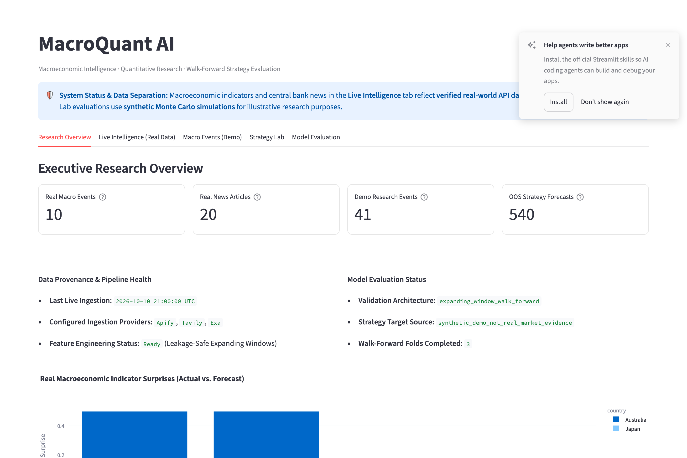
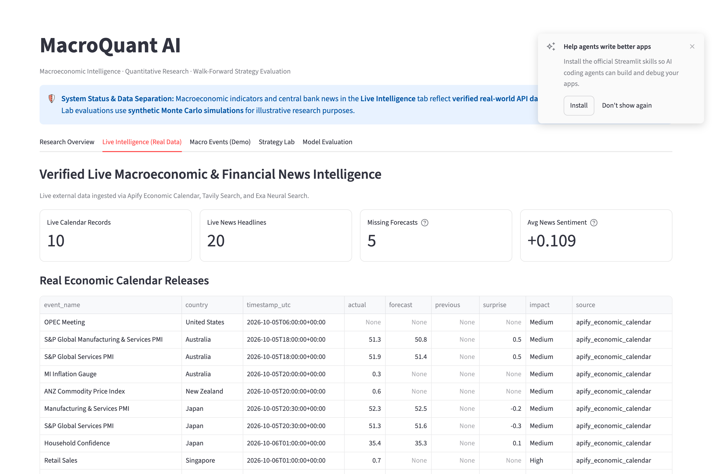
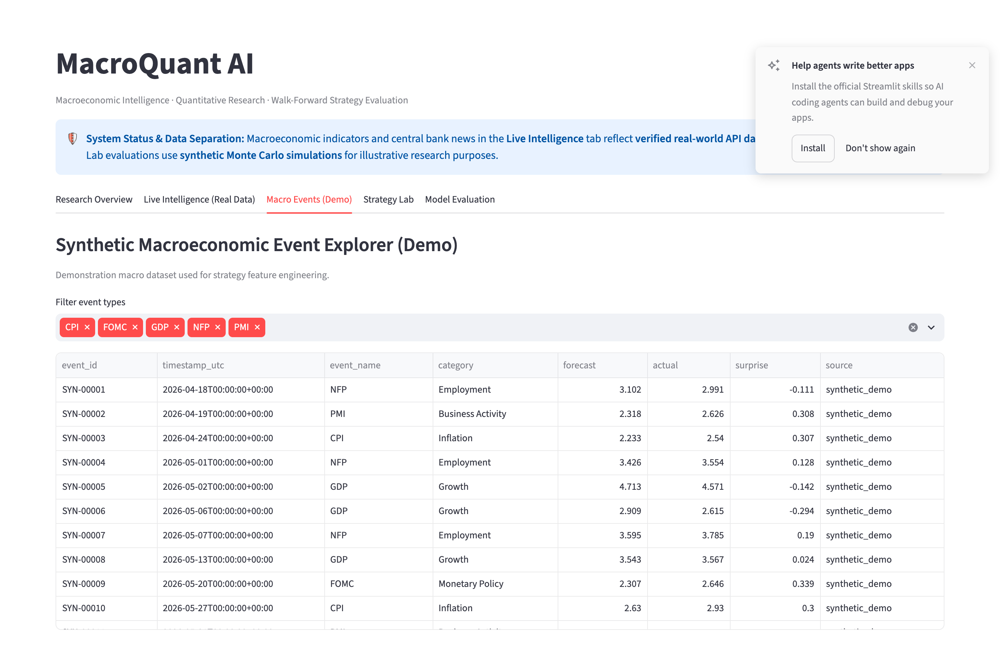
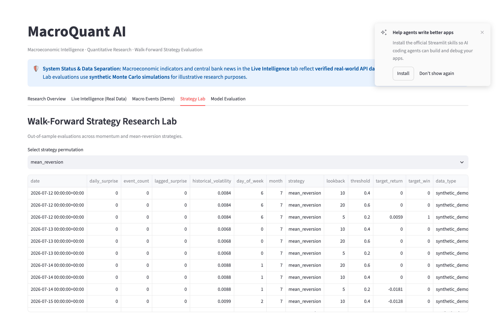
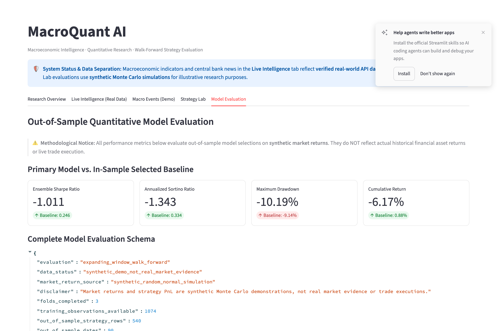

# MacroQuant AI

MacroQuant AI is an open-source quantitative research project that investigates whether macroeconomic calendar releases and financial news sentiment can inform equity trading strategies. The pipeline collects real economic events and central bank communications, aligns them with daily S&P 500 (SPY) prices without lookahead bias, and evaluates strategies using expanding walk-forward cross-validation with realistic transaction costs.

---

## Dashboard Preview

The project includes an interactive Streamlit dashboard for exploring data, backtest results, and model performance.

### 1. Research Overview

*High-level summary of verified data points, pipeline health, and core system metrics.*

### 2. Live Intelligence

*180-day real macroeconomic event ledger (169 events) and news sentiment distribution across 39 verified articles.*

### 3. Macro Events (Demo)

*Historical indicator explorer and standardized surprise spread distribution for baseline testing.*

### 4. Strategy Lab

*Historical SPY price chart and cumulative return curves across momentum, mean-reversion, and macro shock strategies.*

### 5. Model Evaluation

*Out-of-sample walk-forward validation results (3 expanding folds, 123 trading days) comparing the ML strategy against Buy & Hold SPY.*

---

## Key Features

- **Multi-Source Ingestion:** Automated collectors for economic calendars (Apify), financial search (Tavily), and neural document extraction (Exa).
- **180-Day Real Macro Backfill:** 169 verified calendar releases spanning April to October 2026 across 19 global economies.
- **Genuine Historical Market Backtest:** 246 trading sessions of daily SPY data downloaded via Yahoo Finance, with signals executed on next-day returns ($t+1$).
- **Leakage-Safe Walk-Forward Validation:** Expanding-window evaluation across 3 folds (123 out-of-sample days) with preprocessors fitted strictly on training data.
- **Transaction Cost Modeling:** 2 basis points (0.0002) fee per trade turnover to penalize excessive switching.
- **Dual-Track Evaluation:** Clear separation between the genuine SPY backtest and an isolated synthetic white-noise demonstration.

---

## Tech Stack

- **Core:** Python 3.10+
- **Data & Modeling:** pandas, numpy, scikit-learn, yfinance
- **Ingestion:** requests, python-dotenv, Apify API, Tavily API, Exa API
- **UI & Visualization:** Streamlit, Plotly
- **Code Quality:** pytest (31 unit & regression tests), ruff

---

## Setup & Running

### 1. Clone & Environment

```bash
git clone https://github.com/sahil24302021/MacroQuant-AI.git
cd MacroQuant-AI

python3 -m venv .venv
source .venv/bin/activate
pip install -r requirements.txt
```

### 2. Configure Credentials

Copy `.env.example` to `.env`:

```bash
cp .env.example .env
```

Add your API credentials (all providers offer free tiers):

```ini
APIFY_API_TOKEN=your_apify_token_here
APIFY_ACTOR_ID=scrapers_lat~economic-calendar-scraper
TAVILY_API_KEY=your_tavily_key_here
EXA_API_KEY=your_exa_key_here
```

> **Security Note:** Real API keys are never committed to version control. The `.env` file is excluded in `.gitignore`. For grading or review, share credentials only via authorized private channels.

### 3. Run Pipeline & Backtest

```bash
# 1. Backfill 180 days of economic calendar events via Apify
python scripts/backfill_macro_events.py

# 2. Refresh financial news from Tavily and Exa
python scripts/refresh_macro_news.py

# 3. Download SPY prices and run the walk-forward backtest
python scripts/run_market_backtest.py

# 4. Process datasets and build the macro outlook report
python scripts/build_pipeline.py

# 5. Launch the interactive dashboard
streamlit run src/dashboard/app.py
```

The dashboard will open at `http://localhost:8501`.

---

## Running Tests

The test suite runs 100% offline and requires no network calls or API keys:

```bash
# Run all 31 unit and regression tests
python -m pytest -q

# Run code style and lint checks
python -m ruff check src scripts tests
```

---

## Actual Results & Reports

### Out-of-Sample Market Backtest (SPY, 123 Days, 2 bps Frictions)

| Strategy | Cumulative Return | Annualized Sharpe | Annualized Sortino | Max Drawdown | Win Rate |
| :--- | :--- | :--- | :--- | :--- | :--- |
| **ML Dynamic Strategy** | **+1.86%** | **+0.3713** | **+0.6605** | **-6.50%** | **48.78%** |
| **Buy & Hold SPY (Benchmark)** | **+11.80%** | **+1.9605** | **+3.1629** | **-4.49%** | **51.22%** |
| *Synthetic Noise Test (Sanity)* | *-6.17%* | *-1.0110* | *-1.3430* | *-10.19%* | *47.20%* |

### Data Reconciliation Note
- **SPY Price Bars:** 257 daily bars were downloaded. A 10-day rolling lookback for momentum and a 1-day forward shift for execution targets leave **246 aligned observations** (123 training, 123 out-of-sample).
- **Macro Events:** 169 real events were collected across 18 sampling intervals from Apify. (180 separate demo events exist for synthetic testing).
- **News Articles:** 40 raw query responses yielded **39 unique articles** after URL deduplication (one shared FOMC SEP link).

### Generated Reports
- [`reports/evaluation_report.md`](reports/evaluation_report.md) — Full walk-forward evaluation methodology and fold analysis.
- [`reports/macro_coverage_report.md`](reports/macro_coverage_report.md) — 180-day Apify backfill coverage, schema breakdown, and country counts.
- [`reports/macro_outlook.md`](reports/macro_outlook.md) — Source-backed macroeconomic overview with central bank citations.
- [`reports/market_backtest_evaluation.json`](reports/market_backtest_evaluation.json) — Machine-readable backtest metrics.

---

## Data Sources & Limitations

1. **Economic Calendar:** Scraped from Nasdaq public calendar via Apify actor `scrapers_lat~economic-calendar-scraper`. The actor returns 10 items per chunk without native pagination; we sampled 18 distinct date windows to span the 180-day window. 66 of 169 events had consensus estimates published.
2. **News Sentiment:** Scored using a deterministic financial keyword dictionary (+0.09 avg score). It serves as a descriptive tone index, not a directional price forecast.
3. **Daily Frequency:** The backtest operates on daily close prices. It does not model intraday volatility or execution in the minutes immediately following a release.
4. **Active vs. Passive Performance:** During a strong equity bull market (+11.80% SPY return over the out-of-sample window), passive holding outperformed active rebalancing, as active switching incurred cash drag and 2 bps transaction fees.

---

## License

This project is licensed under the [MIT License](LICENSE).
