# MacroQuant AI — Quantitative Research & Model Evaluation Report

**Document Version:** 1.0.0  
**Evaluation Architecture:** Chronological Expanding-Window Walk-Forward Validation  
**Evaluation Horizon:** 180 Days (Out-of-Sample Window: 90 Days across 3 Folds)  
**Security & Provenance Classification:** Strict Segregation — Real Macroeconomic Sources vs. Synthetic Market Simulation  

---

## 1. Executive Summary

This evaluation report assesses the macroeconomic feature engineering and quantitative strategy selection pipeline developed in the `MacroQuant-AI` research framework.

Key findings include:
1. **Real-World Macro Ingestion:** Ingested and validated real-world macroeconomic calendar events (via Apify) and financial news/central bank publications (via Tavily and Exa). HTML entities (e.g., `&nbsp;`) were cleaned, numeric values were sanitized to strictly finite floats, and previous-value extraction was added without data fabrication.
2. **Leakage-Safe Architecture:** Feature engineering enforces expanding historical windows rather than full-dataset standardization, preventing look-ahead bias. Model preprocessing is encapsulated in scikit-learn pipelines fitted strictly on training data within each walk-forward fold.
3. **Out-of-Sample Performance Reality:** The model was tested against synthetic market returns generated under a controlled random normal distribution. The ensemble strategy selector yielded an annualized Sharpe ratio of **-1.011** (cumulative return of **-6.17%**, max drawdown of **-10.19%**) across 90 out-of-sample trading days, compared to a naive in-sample chosen single baseline strategy Sharpe of **+0.246**.
4. **Essential Integrity Disclaimer:** Market prices and strategy returns currently derive from **synthetic Brownian motion simulations**. They serve to validate the machine learning architecture and leak-free backtesting mechanics, but **must never be cited as evidence of real-world trading profitability**.

---

## 2. Data Sources & Provenance Architecture

The project enforces an explicit separation between verified external macro intelligence and internal simulated strategy testbeds:

| Source | Provider | Role in System | Provenance Tag | Verified Status |
| :--- | :--- | :--- | :--- | :--- |
| **Economic Calendar** | Apify (`scrapers_lat~economic-calendar-scraper`) | Macro indicator releases (actual, forecast, previous, surprise) | `real_verified` | Verified live (7-day test slice) |
| **Financial Search** | Tavily Search API | Macro news headlines, Fed speeches, BLS portal reports | `real_verified` | Verified live (10 records) |
| **Neural Web Search**| Exa AI Search API | Deep web content, Governor Waller speech, SEP projections | `real_verified` | Verified live with full text (10 records) |
| **Simulated Market** | NumPy Random Generator (`seed=2026`) | Simulated asset returns for strategy evaluation | `synthetic_demo` | Illustrative Monte Carlo simulation |

### Data Cleaning & Normalization Protocol
- **HTML Artifacts:** Extracted strings are unescaped (`html.unescape`) and cleared of non-breaking spaces (`&nbsp;`, `\xa0`).
- **Missing Value Handling:** Missing, empty, or unreleased values (e.g., meetings without consensus forecasts) remain strictly `None`/`null`. Zeroes or synthetic interpolations are **never** invented.
- **Timestamp Standardization:** Calendar timestamps with explicit GMT notations are normalized to ISO-8601 UTC (`YYYY-MM-DDTHH:MM:SS+00:00`). Unknown timezones are tagged as `unspecified` without silent guesswork.
- **Deduplication:** Overlapping chunks and duplicate URLs are filtered by composite unique keys `(event_name, date, time, country, actual, forecast)` and unique web URLs.

---

## 3. Walk-Forward Validation Methodology

To ensure robust evaluation without look-ahead bias or target leakage, the system uses an expanding chronological walk-forward split:

```mermaid
gantt
    title Expanding Window Walk-Forward Validation Scheme
    dateFormat  X
    axisFormat  Day %s
    section Fold 1
    Train Fold 1 (Days 0-90)     :active, 0, 90
    Test Fold 1 (Days 90-120)    :crit, 90, 120
    section Fold 2
    Train Fold 2 (Days 0-120)    :active, 0, 120
    Test Fold 2 (Days 120-150)   :crit, 120, 150
    section Fold 3
    Train Fold 3 (Days 0-150)    :active, 0, 150
    Test Fold 3 (Days 150-180)   :crit, 150, 180
```

1. **Initial Training Partition:** 50% of the timeline (90 days) is reserved for baseline discovery and initial training.
2. **Expanding Train Windows:** As time progresses, earlier test folds are added to the training set for subsequent folds.
3. **Out-of-Sample Predictions:** The model predicts next-day strategy returns strictly for unseen future periods.
4. **Strategy Decision Rule:** On each out-of-sample date, the model selects the single strategy with the highest predicted return.

---

## 4. Quantitative Results & Baseline Comparison

### Summary Performance Metrics Table

| Metric | Selected Ensemble Strategy (Out-of-Sample) | Baseline: Best In-Sample Strategy (`momentum`) | Variance / Difference |
| :--- | :--- | :--- | :--- |
| **Evaluation Observations** | 90 days | 90 days | 0 days |
| **Total Strategy Rows** | 540 rows (6 strategies × 90 days) | 90 days (1 strategy × 90 days) | — |
| **Mean Daily Return** | **-0.0655%** | **+0.0136%** | -0.0791% |
| **Annualized Sharpe Ratio** | **-1.011** | **+0.246** | -1.257 |
| **Annualized Sortino Ratio** | **-1.343** | **+0.334** | -1.677 |
| **Maximum Drawdown** | **-10.19%** | **-9.14%** | -1.05% |
| **Cumulative Return** | **-6.17%** | **+0.88%** | -7.05% |

### Interpretation & Analysis
- **Model Overfitting on Noise:** Because the underlying market returns in the demonstration dataset are pure Gaussian white noise with zero true autocorrelation or macroeconomic cointegration, the Random Forest model overfit in-sample historical fluctuations. Consequently, out-of-sample strategy selection underperformed the simple static momentum benchmark.
- **Transaction Costs Impact:** Both strategies incorporate a modeled 2 bps transaction friction per trade. The ensemble's frequent strategy switching incurred higher cumulative drag.
- **Evaluation Integrity:** These negative out-of-sample results on synthetic noise demonstrate that the evaluation harness correctly penalizes overfitting and prevents look-ahead leakage, avoiding artificial positive returns.

---

## 5. Methodological Limitations & Future Milestones

1. **Synthetic Market Target Constraint:**
   - Real macroeconomic events and news are currently decoupled from market pricing: asset returns in the Strategy Lab are generated via synthetic random normal simulations.
   - *Next Milestone (Planned):* Ingest genuine daily asset prices (e.g., SPY, TLT, DXY via financial market APIs) to evaluate authentic post-announcement price discovery.
2. **Apify Live Coverage Scope (7-Day Slice vs. 180-Day Backfill):**
   - Live calendar ingestion currently consists of a verified 7-day test slice (10 events).
   - The 180-day timeline in `macro_events.csv` and `strategy_dataset.csv` is strictly a synthetic demonstration dataset.
   - *Next Milestone (Planned):* Execute a full 180-day historical backfill across chunked date intervals using targeted country and high-impact filters.
3. **News Sentiment Heuristic:**
   - News sentiment scores are computed using a deterministic lexical keyword matching approach (hawkish vs. dovish terms). This is a descriptive tone proxy, not an econometric prediction.
   - *Next Milestone (Planned):* Evaluate transformer-based financial language models (such as FinBERT) for contextual sentiment extraction.
